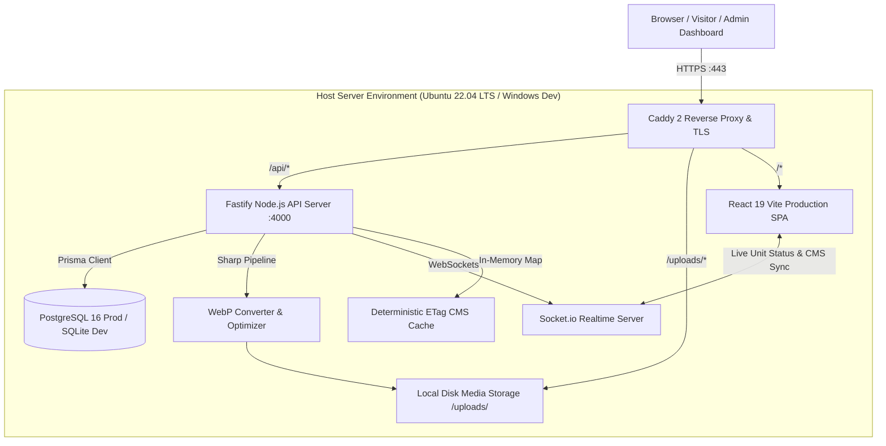

# Ajda Real Estate Platform — System Architecture

> **Last Updated**: 2026-10-26  
> **Status**: Production Architecture (Backend + Frontend + Realtime + CMS Engine + Auth + Admin i18n)

---

## 1. System Overview

Ajda Real Estate is an enterprise real estate development and asset management platform for Saudi Arabia. It runs on a high-throughput, containerless architecture with an in-memory cached Content Management System (CMS), real-time unit synchronization, and granular role/action-based permissions.



---

## 2. Technology Stack

### Frontend
| Layer | Technology | Details |
|---|---|---|
| **Framework** | React 19 + TypeScript + Vite | Client-rendered SPA architecture |
| **Styling** | Tailwind CSS v4 + Vanilla CSS | Bespoke RTL (Arabic primary) / LTR (English secondary) |
| **Icons** | Lucide React | Uniform SVG icon design system |
| **Realtime** | `socket.io-client` | Auto-reconnect, consumer ref-counting, live unit & CMS revalidation |
| **Maps** | Google Maps Loader + Leaflet | Interactive Saudi property map with custom coordinate pins |
| **3D Rendering** | Three.js | Building elevations and floor visualizations |
| **CMS Client** | `CmsProvider` + SWR Hook | 0ms instant paint via `localStorage`, HTTP 304 ETag revalidation |

### Backend
| Layer | Technology | Details |
|---|---|---|
| **Runtime** | Node.js (24 in production and CI; 20+ works) | Native TypeScript (`tsx` dev / `tsc` build) |
| **Framework** | Fastify v5 | High throughput, asynchronous schema validation, lifecycle hooks |
| **Database** | PostgreSQL 16 (Prod) / SQLite (Dev) | Native installation, zero Docker overhead |
| **ORM** | Prisma v6 | Type-safe schema, migrations, automated seeders |
| **Media Processing** | Sharp | Automatic WebP conversion, EXIF stripping, size compression |
| **Auth & Security** | `@fastify/jwt` + bcrypt, `@simplewebauthn/server` | JWT sessions, email verification and login codes, authenticator-app TOTP with recovery codes, passkeys, rate-limiting, granular RBAC (see section 10) |
| **Realtime** | Socket.io Server | Real-time unit availability, new inquiry alerts, CMS push updates |
| **Queue** | BullMQ + Redis, `sync` fallback | Mail and notification jobs (section 8) |
| **Testing** | Vitest | 44 backend test files, 428 tests (security, authorization, CRUD, auth factors) |

### Production Infrastructure (No Docker)
| Component | Technology | Management |
|---|---|---|
| **Reverse Proxy** | Caddy 2 | systemd service, Cloudflare Origin CA TLS termination, gzip/zstd |
| **API Process** | Node.js Fastify | systemd service (`Restart=always`), journald logging |
| **Database** | PostgreSQL 16 | systemd service, daily automated `pg_dump` cron |
| **Static Media** | Local filesystem | `/srv/ajda/app/server/uploads/` (production) served by Fastify static; CVs live in the private `server/private/` folder and are never served directly |

---

## 3. Directory Layout

```
ajda/
├── deploy/                      # Deployment playbook (README-deploy.md), Caddyfiles, systemd units, deploy scripts
├── docs/                        # Project documentation suite
│   ├── archive/                 # Historical reference (original refactor.md, Kimi reviews)
│   ├── README.md                # Documentation navigation hub
│   ├── architecture.md          # System design and specifications (this file)
│   ├── cms-architecture.md      # Approved CMS v2.1 architectural plan
│   ├── api-reference.md         # Comprehensive REST & WebSocket API catalog
│   ├── ADMIN-I18N.md            # Admin AR/EN translation spec and rules
│   ├── admin-audit.md           # Admin dashboard audit (P0-P3 backlog)
│   ├── github-actions-deploy.md # CI deploy of the test instance
│   ├── reviews/                 # Dated review reports
│   ├── prompts/                 # Task prompts and reports for implementing agents
│   ├── testing-strategy.md      # Testing matrix and test suites
│   ├── gap-analysis.md          # Modern admin feature comparison
│   ├── CHANGELOG.md             # Chronological release and feature changelog
│   └── TODO.md                  # Active tasks, blockers, and roadmap
├── public/                      # Static assets & client logos
├── server/                      # Fastify backend application
│   ├── prisma/                  # Schema, migrations, seed scripts
│   ├── src/                     # Source code (routes, services, schemas, sockets)
│   └── test/                    # Vitest integration test suites
├── src/                         # React 19 frontend application
│   ├── components/              # UI components (admin, home, common, works)
│   ├── context/                 # Context providers (CmsProvider, Theme, Language)
│   ├── hooks/                   # Custom React hooks (useCmsContent, useRealtimeUnits)
│   ├── pages/                   # Public and admin route pages
│   ├── services/                # API client services
│   └── types/                   # TypeScript interfaces (cms.ts, property.ts, admin.ts)
├── CLAUDE.md                    # Planner context (read first by Claude Code)
├── refactor.md                  # Owner requests log
└── salah-tasks.md               # Owner's own actions (secrets, servers, first deploy)
```

---

## 4. Database Schema & Data Models

### 4.1 Real Estate Core Domain
- **`Project`**: Property development record (`title`, `slug`, `city`, `type`, `publishStatus`, `coordinates`).
- **`PropertyFloor`**: Architectural floor associated with a project (`floorNumber`, `floorNameAr/En`, `units`).
- **`PropertyUnit`**: Individual commercial/logistics/residential unit (`unitNumber`, `area`, `status`, `price`).
- **`CustomerInquiry`**: CRM lead generated from public contact/booking forms (`name`, `phone`, `type`, `notes`).
- **`CategoryItem`**: Managed taxonomy for project classifications and badges.

### 4.2 Content Management System (CMS) Models
- **`CmsSection`**: Document store for core pages (`key` PK, `content` JSON, `version`, `updatedAt`, `updatedById`).
  - Section Keys: `nav`, `footer`, `home`, `works`, `clientsPage`, `contact`.
- **`CmsSectionVersion`**: Audit snapshot table retaining the last 10 versions for 1-click rollback (`sectionKey`, `content`, `version`, `createdAt`, `createdById`).
- **`CmsClient`**: Relational partner/client directory (`nameAr/En`, `sectorAr/En`, `logo`, `tagsAr/En`, `websiteUrl`, `order`, `visible`).

### 4.3 Administration, HR & Security Models
- **`AdminUser`**: Backoffice administrator (`email`, `passwordHash`, `role`, `permissions` JSON, `departmentId`, `emailVerifiedAt`, TOTP secret, avatar).
- **`Role`**, **`Department`**: Access role grouping (`slug`, `nameAr/En`, `permissions` JSON) and team department.
- **`OtpChallenge`**: Emailed 6-digit codes for login, password reset and password change.
- **`EmailVerificationToken`**: Invite and email-verification links and codes.
- **`RecoveryCode`**: Hashed one-time recovery codes for TOTP.
- **`Passkey`**, **`WebauthnChallenge`**: WebAuthn credentials and short-lived registration/login challenges.
- **`NotificationListener`**: Subscription rules for email alerts (new inquiry, new job application).
- **`AppSetting`**: Key/value settings (site contact details, security policy, encrypted SMTP credentials, careers form).
- **`DeveloperNote`**: Bug reports from the floating feedback pet, isolated from CRM data.
- **`NewsletterSubscriber`**: Newsletter sign-ups.

### 4.4 Past Projects and Careers
- **`PastProject`**: "Our previous work" showcase entries (AR/EN title and description, category, image, gallery, publish flag, sort order).
- **`JobApplication`**: Applications from the public careers form (name, phone, email, optional CV stored in `server/private/`).

Failed-login counting is in-process (`loginFailureService.ts`), not a table.

---

## 5. Content Management System (CMS) Engine

### 5.1 High-Performance Multi-Tier Caching & Deterministic ETags
1. **Tier 1 (Instant First Paint - 0ms)**: Synchronously renders compiled defaults (`DEFAULT_CMS_CONTENT`) on cold visits or reads from `localStorage` (`ajda_cms_cache_v2`).
2. **Tier 2 (Deterministic ETag Verification)**:
   - Fastify generates deterministic ETags:
     - Section ETag: `W/"sec-${key}-v${version}-${updatedAt.getTime()}"`
     - Aggregated Content: `W/"cms-agg-v${maxVersion}-${latestTimestamp}"`
   - Client sends `If-None-Match`. On match, server returns **HTTP 304 Not Modified** with 0 bytes body.
3. **Tier 3 (Real-Time Push Invalidation)**:
   - When any admin updates content via `PUT /api/cms/content/:key`:
     - Version increments in DB, in-memory cache evicts stale key.
     - Socket.io broadcasts `cms:updated` and `cms:clients:updated`.
     - Connected clients revalidate silently in the background.

### 5.2 Frontend React CMS Layer & State Architecture
The client-side CMS consumption pipeline is architected for zero flash of unstyled content, instant offline-first rendering, and silent real-time hydration:

- **`CmsProvider` & Context (`src/context/CmsProvider.tsx`, `cmsContextDef.ts`)**:
  - Global provider mounted at the React tree root in `src/main.tsx`.
  - Reads immediately from `localStorage` (`ajda_cms_cache_v2`) on initialization to ensure 0ms first-paint latency.
  - Automatically establishes Socket.io subscription via `realtimeSocket.ts` and listens to `cms:updated`, `cms:clients:updated`, and `cms:cache:cleared`.
  - Re-fetches the latest ETag-validated content in the background and re-renders updated sections without full page reloads. Retains last-good state if network fails.
- **Ergonomic Consumer Hooks**:
  - `useCmsContent(sectionKey)`: Returns reactive section payload, typed directly via TypeScript discriminated unions.
  - `useCmsSection(sectionKey)`: Convenience hook with loading, error, and manual reload dispatchers.
  - `useCmsText(locale)`: Helper to extract localized text (`ar` vs `en`) with automatic fallback to Arabic.
  - `useCmsContact()`: Unified hook returning primary company phone, WhatsApp, email, address, and working hours with fallback.
- **Network & Socket Infrastructure**:
  - `src/services/cmsService.ts`: HTTP API methods handling `If-None-Match` headers, ETag caching, version history inspection, and 1-click rollback calls.
  - `src/services/realtimeSocket.ts`: Reference-counted singleton Socket.io client preventing duplicate socket connections and handling reconnection backoffs.
- **Media & Icon Utilities**:
  - `src/utils/cmsMedia.ts`: Path normalizer resolving `/uploads/`, `assets/...`, external CDN URLs, and extracting embed URLs from YouTube links.
  - `src/components/common/cmsIcons.ts` & `socialIcons.ts`: Maps CMS icon strings to Lucide React icons or SVG brand paths (covering 10 platforms: WhatsApp, X/Twitter, Instagram, LinkedIn, YouTube, Facebook, Snapchat, TikTok, Telegram, GitHub).
- **Public Component Integration**:
  - **`Navbar.tsx` & `Footer.tsx`**: Dynamic menu items, custom CTA button toggle, social channels, and legal copy.
  - **`HomePage.tsx`**: Dynamically toggles and renders 9 sections (`hero`, `about`, `services`, `process`, `projects`, `map`, `clients`, `cta`, `marquee`) based on individual `enabled` flags.
  - **`WorksPage.tsx`**: Header copy, dynamic tag filtering, process methodology cards, featured project banner, and conversion CTA.
  - **`ClientsPage.tsx`**: Hero copy, partners grouped by sector, testimonial slider/grid, and partnership CTA banner.
  - **`PastProjectsPage.tsx`**: Header badge, title, subtitle, empty state text, and SEO metadata loaded from CMS (`pastWorks`).
  - **`CareersPage.tsx`**: Header title, intro copy, submission success message, and SEO metadata loaded from CMS (`careers`).

#### CMS live draft preview

The Site CMS preview is the public site inside an iframe (`?preview=1`). While a panel has unsaved edits, the admin tab sends them to the iframe with `postMessage` and the site renders them in place of the saved content. Drafts live only in React state: they are never written to the server or to the `localStorage` cache.

- Protocol, message types and trust checks: [`src/utils/cmsPreviewProtocol.ts`](../src/utils/cmsPreviewProtocol.ts). Parent to frame: `AJDA_CMS_DRAFT`, `AJDA_CMS_UPDATED`, `AJDA_SET_LANG`. Frame to parent: `AJDA_PREVIEW_READY`, `AJDA_PREVIEW_ERROR`.
- Both sides accept a message only from the same origin and from the expected window (the iframe's parent, or the preview iframe itself). The target origin is never `'*'`.
- Receiver: `CmsProvider` merges drafts over the saved content (one level deep per section). Only the sections in `PREVIEW_DRAFT_KEYS` are accepted; the partner list (`clients`) is not previewed.
- Sender: panels pass a `toDraft` function to `useCmsDirty`; `CmsSection` collects the drafts and `CmsLivePreviewPane` posts them 200 ms after the last change, and again whenever the iframe reports `AJDA_PREVIEW_READY`.
- Read-only: in a preview frame `api.ts` rejects every non-GET request (`Preview is read-only`) and `reportClientError` does nothing.
- Crash fallback: if a draft makes the page throw, `ErrorBoundary` drops the drafts, shows the saved content again and sends `AJDA_PREVIEW_ERROR`; the pane shows a "preview paused" badge until the next valid draft.

---

## 6. Granular Action-Level Permissions Model

Permissions are evaluated through an inheritance and direct-override algorithm:

```
                  ┌────────────────────────────────────────┐
                  │             SUPER_ADMIN                │
                  │        (Full System Access)            │
                  └───────────────────┬────────────────────┘
                                      │
              ┌───────────────────────┴───────────────────────┐
              ▼                                               ▼
┌───────────────────────────┐                   ┌───────────────────────────┐
│     PROJECTS DOMAIN       │                   │        CMS DOMAIN         │
├───────────────────────────┤                   ├───────────────────────────┤
│ viewProjects              │                   │ manageCms                 │
│ createProject             │                   │ manageClients             │
│ editProject               │                   │ rollbackCms               │
│ deleteProject             │                   │                           │
│ publishProject            │                   │                           │
└───────────────────────────┘                   └───────────────────────────┘
```

| Permission Key | Scope | Description |
|---|---|---|
| `manageProjects` | Projects | Create, edit, delete, duplicate and publish projects, floors and categories (this is the key the routes check) |
| `viewProjects`, `createProject`, `editProject`, `deleteProject`, `publishProject` | Projects | Finer-grained keys kept in the catalogue; `manageProjects` implies them (see `server/src/middleware/auth.ts`) |
| `manageUnits` | Units | Floor plan editor, unit CRUD and live unit status toggles |
| `managePastProjects` | Past projects | Manage the "previous work" showcase and its uploads |
| `manageCms` | CMS | Edit page copy, navbar items, footer identity, CMS export/import |
| `manageClients` | CMS | CRUD partners directory, logo uploads, and reordering (`manageCms` implies it) |
| `rollbackCms` | CMS | Revert any CMS section to a previous point-in-time snapshot (`manageCms` implies it) |
| `viewInquiries` | CRM | View inquiries (currently also edit and close them; a separate write permission is open item P0 #1 in `admin-audit.md`) |
| `viewApplications`, `manageApplications` | Careers | Read job applications and CVs; change status, delete, edit the form settings |
| `exportData` | Reports | CSV exports, newsletter list |
| `manageUsers` | HR / Admin | User, role and department administration |
| `verifyUsers` | HR / Admin | Mark a user's email as verified by hand |
| `manageNotifications` | Settings | Notification listeners |

Mail, security and site settings and the developer tools (logs, developer notes) are **super admin only**.

---|---|---|
| `viewProjects` | Projects | View all projects (including drafts/hidden) |
| `createProject` | Projects | Create new property records |
| `editProject` | Projects | Update existing properties, pricing, and media |
| `deleteProject` | Projects | Delete properties from the system |
| `publishProject` | Projects | Toggle public visibility (`published` / `draft` / `hidden`) |
| `manageCms` | CMS | Edit page copy, navbar items, and footer identity |
| `manageClients` | CMS | CRUD partners directory, logo uploads, and reordering |
| `rollbackCms` | CMS | Revert any CMS section to a previous point-in-time snapshot |
| `manageUnits` | Units | Interactive floorplan editor and live unit status toggles |
| `viewInquiries` | CRM | Customer inquiry management and status tracking |
| `exportData` | Reports | CSV and JSON data export |
| `manageUsers` | HR / Admin | User account administration, department assignment, and permission grants |
| `manageNotifications` | Settings | Email listener setup and SMTP delivery parameters |

---

## 7. Production Telemetry & Dedicated Error Logging

The platform features a multi-tiered diagnostic logging and telemetry architecture:

```
┌────────────────────────────────────────────────────────┐
│                   DIAGNOSTIC PIPELINE                  │
└────────────────────────────────────────────────────────┘
                           │
       ┌───────────────────┴───────────────────┐
       ▼                                       ▼
┌─────────────────────────┐         ┌─────────────────────────┐
│     HTTP REQUESTS       │         │    APPLICATION ERRORS   │
│  (Fastify onResponse)   │         │ (5xx, crashes, rejects) │
└────────────┬────────────┘         └────────────┬────────────┘
             │                                   │
             ▼                                   ▼
┌─────────────────────────┐         ┌─────────────────────────┐
│   In-Memory Ring Buffer │         │    Dedicated Log File   │
│   (Last 2,000 entries)  │         │   (server/errors.log)   │
└────────────┬────────────┘         └────────────┬────────────┘
             │                                   │
             ▼                                   ▼
┌─────────────────────────┐         ┌─────────────────────────┐
│ Persistent Stream File  │         │ Client Telemetry Beacon │
│    (server/prod.log)    │         │ (POST /logs/client-err) │
└─────────────────────────┘         └─────────────────────────┘
```

1. **Dual Storage Engine**:
   - **In-Memory Ring Buffer**: Fixed 2,000-event circular buffer for instant 0ms retrieval via `/api/logs` and the dark-mode HTML monitor at `/api/logs/view`.
   - **Persistent Stream (`server/prod.log`)**: Asynchronous non-blocking file append stream.
2. **Dedicated `server/errors.log`**:
   - High-priority, isolated error log destination. Any entry logged with level `error` is written to `errors.log` with timestamp, source, message, context, and stack trace.
   - Global process crash listeners (`unhandledRejection` and `uncaughtException`) ensure zero silent fatal errors.
3. **Client-Side Error Telemetry (`POST /api/logs/client-error`)**:
   - Frontend unhandled errors (`window.addEventListener('error')`, `window.addEventListener('unhandledrejection')`, and failed API network requests) are automatically captured and dispatched via a keep-alive beacon to the server, logging frontend crashes into `server/errors.log`.

---

## 8. Asynchronous Job Queue Architecture (Option C: BullMQ + Redis)

To eliminate UI lag during time-consuming operations (such as multi-second Google SMTP email handshakes and image processing), the backend implements a **Laravel-style `Queueable` Job Queue Engine** with automatic fallback:

```
                ┌──────────────────────────────┐
                │        queueService          │
                │       .dispatch(job)         │
                └──────────────┬───────────────┘
                               │
            ┌──────────────────┴──────────────────┐
            ▼                                     ▼
   [Redis Available]                     [Redis Offline / None]
   (bullmq worker pool)                  (Graceful Sync Fallback)
            │                                     │
   Enqueues job (<2ms)                   Executes job inline (await)
   Returns HTTP 201 immediately          Returns HTTP 201 after job
   Worker processes in background        Guarantees delivery with 0 deps
```

### Architecture Specifications:
1. **`QueueableJob<T>` Interface**:
   ```ts
   export interface QueueableJob<T = unknown> {
     name: string;
     handle(payload: T): Promise<void>;
   }
   ```
2. **Dual-Mode Execution (Redis + Sync Fallback)**:
   - **Primary Driver (Redis + BullMQ)**: When Redis is reachable at `REDIS_URL` or `127.0.0.1:6379`, jobs are pushed to BullMQ queues (`email-queue`, `media-queue`). Responses return in **<20ms**, completely decoupling the client UI from SMTP latency.
   - **Graceful Sync Fallback**: If Redis is not installed, unreachable, or disabled via `QUEUE_DRIVER=sync`, the `QueueManager` logs a single informational message and runs the job synchronously inline without throwing errors.
3. **Target Workloads**:
   - Developer feedback alert emails (`SendDeveloperNoteEmailJob`).
   - Customer inquiry CRM alerts (`SendInquiryNotificationJob`).
   - Admin login 2FA OTP codes (when asynchronous dispatch is appropriate).
   - Asynchronous image thumbnailing and PDF text extraction.

---

## 9. Frontend Route-Level Code Splitting (v1.2.1)

To deliver optimal Core Web Vitals (CWV) and under 1-second First Contentful Paint (FCP) on mobile networks, public customer routes and administrative editing suites are code-split using `React.lazy()` and `<Suspense>`:

- **Public Home Route (`/`)**: Statically imported to guarantee 0ms instant landing paint with zero layout shift (CLS: 0.00).
- **Administrative Suite (`/admin/*`)**: Code-split into a separate **521 kB** chunk (`AdminDashboardPage`) and **18 kB** chunk (`AdminLoginPage`). Public visitors never download administrative dashboards, CMS editors, or management logic.
- **Secondary Public Routes**: `WorksPage` (21 kB), `ProjectDetailPage` (33 kB), `InterestRegistrationView` (14 kB), `ContactPage` (13 kB), and `ClientsPage` (6 kB) load on-demand wrapped in branded `RouteLoadingFallback` skeletons.
- **Performance Impact**: Main entry bundle reduced by **64.4%** (from 1,083 kB down to **385 kB** raw / 115 kB gzipped).

---

## 10. Authentication & Second Factors

Sign-in paths, all ending in the same JWT session:

1. **Password** (`POST /api/auth/login`), then one of: email login code (when the user or the site policy requires it), authenticator-app code, or a forced TOTP enrolment.
2. **Passkey** (WebAuthn, `@simplewebauthn/server`): full alternative to password plus code. The relying-party id is `WEBAUTHN_RP_ID` (default: the host of `APP_URL`); changing the domain later invalidates every registered passkey.
3. **Invite link**: a new user sets their own password (`/api/auth/accept-invite`), or a password set by an admin must first be verified by emailed link or 6-digit code. Super admins are exempt.

Supporting rules: password changes are two-step (emailed code); TOTP secrets are encrypted with `SETTINGS_ENCRYPTION_KEY` (required in production, never change it after anyone enrols); recovery codes are hashed and single-use; per-IP and per-account rate limits and lockouts; a super admin can clear another user's TOTP or passkeys.

## 11. Admin Dashboard Internationalisation

Every admin string lives in `src/i18n/admin/*.ts` as an Arabic/English pair created with `defineStrings`, read through `useAdminT()` and driven by the site language. Rules, glossary and the review checklist are in [ADMIN-I18N.md](ADMIN-I18N.md). API error messages are still English only.

---

## 12. SEO shell

The SPA has no server-side rendering, so crawlers that do not run JavaScript (WhatsApp, X, Facebook, LinkedIn, Bing's first pass) would see one generic page for every URL. Instead, **Caddy sends every page URL to the API, which renders the SPA shell**:

1. Caddy rewrites page requests (no file extension, not `/assets`, `/api`, `/uploads`, `/socket.io`) to `GET /api/seo/shell?path=<original path>`.
2. `server/src/services/seo/` reads `SPA_DIST_DIR/index.html` (re-read when its mtime changes), matches the route (`pages.ts`, mirrors `parsePath` in `src/App.tsx`), loads the project or site settings from the database, and injects `<title>`, description, canonical, robots, OpenGraph, Twitter card and JSON-LD (`RealEstateAgent` + `WebSite` on home, `RealEstateListing` + `BreadcrumbList` on a project, `BreadcrumbList` on inner pages). A `<noscript>` block adds an `<h1>`, the description, links to every page and the published project list, so link discovery works without JavaScript.
3. Status codes are honest: unknown paths and missing, draft or hidden projects return **404 + noindex** (the SPA still renders). Admin paths are noindex with no social tags or data. Results are cached 60 s per path and carry an `ETag`.
4. If the API answers 5xx or is down, Caddy serves the static `index.html` (`handle_response` and `handle_errors` in `deploy/Caddyfile.*`), so SEO never takes the site down.
5. `/robots.txt` and `/sitemap.xml` are generated by the API (`server/src/routes/seo.routes.ts`).

**Safety default:** `SEO_INDEXING` is `off` unless set to `on` (production only). Off means `Disallow: /`, an empty sitemap, `noindex, nofollow` in the meta tag and in `X-Robots-Tag`, so the test instance and local runs can never be indexed. The absolute origin always comes from `APP_URL` (production: `https://ajdaa.sa`), never from the `Host` header. All text is HTML-escaped and JSON-LD is serialised with `<`, `>`, `&` escaped, so project titles cannot inject markup (tested).

**Client contract (`src/seo/`, `src/hooks/useSeo.ts`):** every tag the server injects carries `data-seo="1"`. After the first load the client hook removes all `head [data-seo]` elements and writes a fresh set on every route or language change, so there are never duplicates. Public navigation is always a real `<a href>` (`SpaLink`) that still navigates without a reload, so crawlers can follow it.

**Bilingual English routes and hreflang (`task-seo-e`):** Public English routes live at `/en` (home), `/en/{page}` (works, clients, past-works, careers, booking, contact) and `/en/projects/{slug}-{id}`. Every indexable page in both languages emits the `hreflang` trio (`ar`, `en`, `x-default` pointing to Arabic). The XML sitemap (`/sitemap.xml`) lists both languages with bidirectional `xhtml:link` entries. Admin routes are never prefixed (`/en/admin` is 404).

**Project URLs:** the canonical form is `/projects/{slug}-{id}` (e.g. `/projects/villa-riyadh-206`), or `/projects/{id}` when the project has no English title. In English, it is `/en/projects/{slug}-{id}`. The slug is computed at runtime from `titleEn` (`server/src/services/seo/slug.ts`, identical copy in `src/seo/slug.ts`), so **no schema change or migration is needed**. Only the trailing id selects the project; `/projects/206`, `/project/206` and a wrong slug all render the same page with the canonical tag pointing at the slug URL (no 301s). The sitemap, JSON-LD and noscript links use the canonical form, and the client rewrites the address bar with `replaceState` once the project is loaded.

## 13. Drive uploads, zip download and extract

**Uploads.** `ensureFolderPath` is race-safe: parallel requests of a folder upload share one in-flight creation per parent and name (an in-process lock, plus a re-read when the insert hits a 409), so a folder is created once instead of failing every other request with 409. The admin UI uploads through a queue (`UploadManagerContext`, 3 uploads at a time) and shows one panel (`UploadManagerDrawer`) instead of one card per file.

**Zip download.** A POST creates a single-use 60 s ticket kept in memory; the browser then navigates to the GET URL, which streams the archive straight to disk (`driveZipService`, archiver). No `Authorization` header is needed on the GET because the ticket is the credential. Tickets live in one process and do not survive a restart, which is fine for a 60 s window.

**Extract here.** `driveExtractService` (yauzl) unpacks a zip into a new folder. Entry names are normalised and anything that could leave the folder (`..`, absolute, drive letter, NUL) is skipped; symlinks and other non-regular entries, `__MACOSX`, `.DS_Store`, `Thumbs.db` and encrypted entries are skipped; at most 10 000 entries, 5 GB extracted and 2 GB for the zip itself; free disk space is checked first; the bytes actually written are counted while streaming and compared with the header (zip bomb guard); entries are streamed one at a time; any failure removes everything the run created. One extraction runs at a time per process. yauzl is opened with `decodeStrings: false` because with decoding on it refuses the whole archive at the first hostile name instead of letting us skip it.

## 14. Library folders (virtual)

The media library is organised with virtual folders: table `media_folders` (self-relation, parent delete is restricted) and `media_files.folderId` (set to null when a folder row disappears). Folders exist only in the database; files stay flat under `UPLOAD_DIR`, so moving or renaming never touches the disk and public URLs never change. `mediaFolderService` enforces unique sibling names (case-insensitive, in code because a nullable parent cannot carry a unique index), a depth of 5 and no cycles; deleting a folder moves its files and subfolders up one level in one transaction. A zip extracted into the library gets its own folder named after the zip. The Drive (private) keeps its own separate folder tables on purpose: public and private storage stay a hard boundary. The admin Files page reuses Drive's name dialog, folder picker and breadcrumb for the Library tab.
