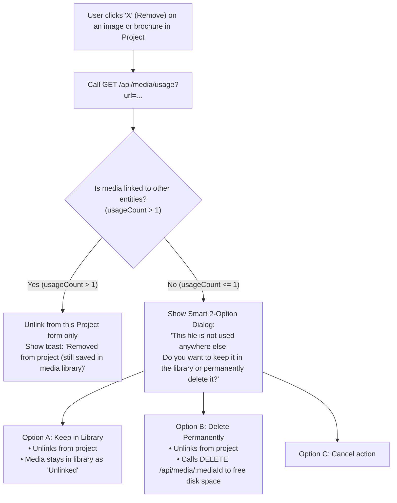

# Ajda Storage & Media System — Master Architecture & Implementation Plan
*(Verified & Hardened on 2026-11-08: Zero Flaws Review)*

> **Core Philosophy**: **Start with what already exists and deliver immediate value**.
> 1. **Step 0 (First Priority)**: Upgrade the existing media upload system into a full **Media Library (`/admin/media`)** with database tracking (`MediaFile`), usage detection (linked vs unlinked/orphaned), a reusable media picker across all admin upload forms, and a smart two-stage "unlink vs delete" confirmation flow.
> 2. **Steps 1 to 6**: Build upon this solid foundation to layer on hierarchical folders (Google Drive-style), trash cascade, 1 GB chunked uploads, and interactive Three.js 3D viewers.

---

## 1. High-Level Progressive Roadmap

```mermaid
flowchart TD
    Step0["Step 0: Media Library, Usage Registry & Smart Picker (First Priority)<br/>• DB model: MediaFile + migration for manageMedia permission<br/>• Auto-index pre-existing disk uploads on startup<br/>• POST /api/media/upload creates MediaFile records<br/>• GET /api/media with usage detection (linked vs orphaned)<br/>• Admin Media Page (/admin/media) with usage badges<br/>• Reusable <MediaPickerModal /> in all admin upload forms<br/>• Smart Unlink vs Delete: 1-item prompt to delete from library or keep"]
    
    Step1["Step 1: Hierarchical Folders & Core Drive MVP<br/>• Schema: StorageFolder & folder associations<br/>• Drive API: create folder, list contents, rename, download<br/>• Drive UI at /admin/storage with breadcrumbs & tree"]
    
    Step2["Step 2: Organization, Trash Cascade & Storage RBAC<br/>• Move items between folders with cycle prevention<br/>• Soft-delete to Trash with folder cascade & restore<br/>• Recursive physical disk purge<br/>• RBAC: viewStorage, uploadStorage, manageStorage"]
    
    Step3["Step 3: Unified Asset & Folder Picker<br/>• Connect Drive folders directly to the Asset Picker<br/>• Auto-organize uploads into project folders (/Projects/{Name}/)"]
    
    Step4["Step 4: 1 GB 3D Models & Resumable Chunking<br/>• 15 MB chunk slices via File.slice()<br/>• Offset/part-file writes with size & hash verification<br/>• Safe retries (flat < 20MB RAM, no file corruption)<br/>• Correct GLB magic (0x67 0x6C 0x54 0x46)"]
    
    Step5["Step 5: Three.js Interactive 3D WebGL Viewer<br/>• 360° orbit controls using existing 'three' package<br/>• Progress bar & drawer previews for 3D, PDF, and images"]
    
    Step6["Step 6: Quality Gates & Verification<br/>• Vitest suites, linting (0 new warnings), production builds<br/>• Arabic (RTL) & English (LTR) browser QA<br/>• Mobile responsiveness (390px)"]

    Step0 --> Step1 --> Step2 --> Step3 --> Step4 --> Step5 --> Step6
```



---

## 2. Step 0: Media Library, Usage Registry & Smart Project Picker (Detailed Spec)

### 2.1 Database Modeling (`MediaFile`)
Currently, `POST /api/media/upload` writes files to disk without any database record. We add the `MediaFile` model to `server/prisma/schema.prisma`:

```prisma
/// Tracks every uploaded media asset on disk with metadata and usage state
model MediaFile {
  id           String    @id @default(uuid())
  url          String    @unique // e.g. "/uploads/uuid.webp" or "/uploads/uuid-doc.pdf"
  filename     String    // e.g. "uuid.webp"
  originalName String    // e.g. "tower-exterior.jpg"
  mimeType     String    // e.g. "image/webp", "application/pdf"
  fileType     String    // 'image' | 'pdf' | 'model3d' | 'document' | 'other'
  size         Int       // in bytes (standard Int, JSON-safe up to 2.14 GB)
  storageKey   String    // Relative disk path under UPLOAD_DIR
  thumbnailUrl String?   // Generated thumbnail for raster images
  metadata     String?   // JSON: { width, height, format }
  createdById  String?
  createdAt    DateTime  @default(now())
  updatedAt    DateTime  @updatedAt

  @@index([fileType])
  @@index([createdAt])
  @@map("media_files")
}
```

### 2.2 Permissions & Migration (Full Stack Synchronization)
To prevent TypeScript errors and ensure complete system integration, `manageMedia` is registered across all 4 locations:

1. **Server Permission Catalogue**:
   * Add `manageMedia` to `server/src/config/permissions.ts` (`PERMISSION_CATALOGUE` and `PERMISSION_KEYS`).
   * Add `manageMedia` to `AdminPermission` union in `server/src/types/fastify.d.ts`.
2. **Frontend Permission Types**:
   * Add `manageMedia: boolean;` to `AdminPermissions` in `src/types/admin.ts`.
   * Add `manageMedia` to `PERMISSION_KEYS`, `PERMISSION_LABELS` (Arabic), `PERMISSION_EN_LABELS` (English), and `emptyPermissions()` in `src/components/admin/users/usersModel.ts`.
3. **Database Migration**:
   * Create `server/prisma/migrations/20261108100000_media_library/migration.sql`:
     * Creates table `media_files`.
     * Backfills `manageMedia` into `Role` where `key = 'super_admin'`.
     * Backfills `manageMedia: true` into `AdminUser.permissions` for all `super_admin` accounts.
4. **Pre-Existing Files Auto-Discovery**:
   * When the server boots or when `GET /api/media` is called, a sync check in `mediaService.ts` indexes any pre-existing files found in `server/uploads/` that lack a `MediaFile` record (measuring size via `fs.stat` and detecting MIME via `detectMediaType`). This guarantees all existing site images and PDFs appear immediately in the media library.

### 2.3 Real-Time Usage Tracking Engine
A dedicated service `server/src/services/mediaUsageService.ts` scans all database entities referencing media:

```ts
export interface MediaUsageItem {
  entityType: 'project' | 'pastProject' | 'cmsClient' | 'cmsSection' | 'adminUser';
  entityId: string | number;
  entityTitle: string;
  field: 'image' | 'gallery' | 'brochureUrl' | 'model3dUrl' | 'pdfUrl' | 'logo' | 'content' | 'avatar';
}

export interface MediaUsageResult {
  mediaId?: string;
  url: string;
  filename: string;
  usageCount: number;
  usages: MediaUsageItem[];
}
```

**Scanned Fields & Normalization**:
* `Project`: `image`, `brochureUrl`, `model3dUrl`, and `gallery` (JSON array).
* `PastProject`: `image`, `pdfUrl`, and `gallery` (JSON array).
* `CmsClient`: `logo`.
* `CmsSection`: `content` (searches for occurrences of the filename inside stored JSON).
* `AdminUser`: `avatar`.
* *Optimization*: `getBatchMediaUsage()` runs a single aggregated scan across active entities so that listing 24 media cards executes in one fast round-trip.

### 2.4 Server API Endpoints (`/api/media/*`)

```http
# --- UPLOAD & REGISTRY ---
POST   /api/media/upload
# Auth: authenticate + requireAnyPermission('manageProjects', 'managePastProjects', 'manageMedia', 'manageCms')
# Behavior: Saves file via Sharp/disk + creates MediaFile record -> returns { id, url, filename, originalName, size, fileType }

# --- BROWSE & SEARCH ---
GET    /api/media?page=1&limit=24&type=all&status=all&search=
# Auth: authenticate + requireAnyPermission('manageProjects', 'managePastProjects', 'manageMedia', 'manageCms')
# Query params:
#   type: 'all' | 'image' | 'pdf' | 'model3d'
#   status: 'all' | 'linked' | 'orphaned' (unlinked)
# Returns: { items: (MediaFile & { usageCount: number, usages: MediaUsageItem[] })[], total, page, totalPages }

# --- SINGLE USAGE CHECK ---
GET    /api/media/usage?url={encodedUrl}
# Returns: MediaUsageResult { mediaId, url, filename, usageCount, usages }

# --- DELETE WITH SAFETY GUARD ---
DELETE /api/media/:id?force=false
# Behavior:
#   If usageCount > 0 and force !== 'true': Rejects with HTTP 409 Conflict + usage details.
#   If usageCount === 0 or force === 'true': Deletes MediaFile row + unlinks physical file from disk.
```

### 2.5 Admin Media Page (`/admin/media`)
* **Navigation Integration**:
  * Added to `AdminSection` union and `SIMPLE_SECTIONS` in `src/pages/admin/adminRoutes.ts`.
  * Added to `SECTION_META` in `src/pages/admin/AdminDashboardPage.tsx` with `permission: 'manageMedia'`.
  * Added to Admin Sidebar under the Content (المحتوى) group with an `Image` icon.
  * Added localized labels in `src/i18n/admin/layout.ts` (`'nav.media': 'مكتبة الوسائط'` / `'nav.media': 'Media Library'`).
* **Page Features**:
  * **Header**: Page title, total media count, total disk usage, and `+ رفع وسائط جديدة` (Upload New Media button with drag & drop).
  * **Filter Tabs**:
    * All Media (جميع الوسائط)
    * Linked / In Use (مرتبط بمحتوى - أخضر)
    * Unused / Orphaned (غير مستخدم / معزول - برتقالي)
  * **Type Tabs**: All, Images (صور), PDFs (مستندات), 3D Models (مجسمات).
  * **Media Grid**:
    * Card preview (WebP thumbnail or PDF/3D badge).
    * Original name, file size (KB/MB), upload date.
    * **Usage Badge**:
      * Emerald badge: `مرتبط (3 مشاريع)` — clicking opens a popover showing the exact names of linked projects.
      * Amber badge: `غير مستخدم (0)` — candidate for cleanup.
    * 3-dot menu: **نسخ الرابط** (Copy URL), **تحميل** (Download), **حذف** (Delete).
  * **Safe Delete Modal**:
    * If file is orphaned: Simple confirmation dialog.
    * If file is in use: Strong warning listing referencing projects before permitting deletion.

### 2.6 Reusable Media Picker Modal (`<MediaPickerModal />`)
Can be opened from **any upload window** in the admin dashboard:
* **Props**:
  ```tsx
  interface MediaPickerModalProps {
    open: boolean;
    onClose: () => void;
    onSelect: (media: { url: string; filename: string; originalName: string }) => void;
    fileType?: 'image' | 'pdf' | 'model3d' | 'all';
    title?: string;
  }
  ```
* **Dual Tabs**:
  1. **"اختر من المكتبة" (Choose from Library)**:
     * Search and filter by mime type.
     * Click any existing media item to instantly select and attach it.
  2. **"رفع ملف جديد" (Upload New File)**:
     * Standard drag & drop or file picker.
     * Uploads via `POST /api/media/upload`, registers in `MediaFile`, and automatically selects it.

### 2.7 Smart Unlink vs Delete Flow in Project Forms
When an administrator clicks the **"X" (Remove)** button on an image, gallery item, or brochure PDF inside a Project form (`ProjectCreateModal`, `ProjectEditSection`, `PastProjectsSection`):



---

## 3. Subsequent Steps Overview (From Media to Full Drive)

### Step 1: Hierarchical Folders & Core Drive MVP
* Add `StorageFolder` model and link `MediaFile`/`StorageFile` to folders (`folderId`).
* Build `/admin/storage` explorer with breadcrumb navigation and folder tree.
* Implement folder creation, folder renaming, file downloading, and folder nesting.

### Step 2: Organization, Trash Cascade & Permissions
* Move files and folders with cycle prevention (`targetParentId !== folder.id` and no descendant loops).
* Soft-delete to Trash (سلة المحذوفات) with recursive folder cascade.
* One-click restore (with orphan re-parenting) and permanent purge unlinking files from disk.
* Dedicated permissions: `viewStorage`, `uploadStorage`, `manageStorage`.

### Step 3: Unified Asset & Folder Picker
* Enhance `<MediaPickerModal />` into `<AssetPickerModal />` allowing browsing by folder hierarchy.
* Direct upload automatically organizes assets into project folders (e.g. `المشاريع/{اسم المشروع}/`).

### Step 4: 1 GB 3D Models & Resumable Chunking
* Resilient chunked upload engine (15 MB slices, part-file writes, declared size + hash verification).
* Zero heap spike (flat < 20 MB RAM) during 1 GB streaming writes.
* Correct GLB magic bytes: `[0x67, 0x6C, 0x54, 0x46]`.

### Step 5: Three.js Interactive 3D WebGL Viewer
* Embedded 3D viewer built with the project's existing `three` (^0.185.1) and `GLTFLoader`.
* 360° orbit controls, zoom, lighting presets, and loading progress bar.
* Secure iframe fallback for external virtual tours (Matterport / Kuula).

### Step 6: Hardening, Quality Gates & Verification
* Full Vitest integration test suite (`server/test/media.test.ts`, `server/test/storage.test.ts`).
* Full project gates: `npm run lint`, `npm run build`, `npm --prefix server run build`.
* Complete Arabic (RTL) & English (LTR) browser QA on desktop and mobile (390px).

---

## 4. Execution Checklist for Step 0

To implement **Step 0** in `D:\projects\html\ajda-wt\ajda-storage`:
- [ ] **Worktree Environment Setup**:
  - Create `server/.env` with distinct PORT (e.g. 4002), `QUEUE_DRIVER=sync`, empty `MAIL_*`.
  - Create `.env.local` with `VITE_API_URL=http://localhost:4002`.
  - Install dependencies (`npm install` / `npm --prefix server install`).
  - Seed local SQLite `dev.db`.
- [ ] **Prisma & Schema**:
  - Add `MediaFile` to `server/prisma/schema.prisma`.
  - Run `prisma db push` and `prisma generate`.
- [ ] **Permissions System**:
  - Add `manageMedia` to `server/src/config/permissions.ts` and `server/src/types/fastify.d.ts`.
  - Add `manageMedia` to `src/types/admin.ts` and `src/components/admin/users/usersModel.ts`.
  - Write handcrafted migration `server/prisma/migrations/20261108100000_media_library/migration.sql`.
- [ ] **Upload Route Update**:
  - Update `server/src/routes/media.routes.ts` to register uploads in `MediaFile`.
  - Add legacy disk auto-discovery on startup in `server/src/services/mediaService.ts`.
- [ ] **Usage Service**:
  - Implement `server/src/services/mediaUsageService.ts` (scanning Project, PastProject, CmsClient, CmsSection, AdminUser).
- [ ] **Media API Routes**:
  - Implement `GET /api/media`, `GET /api/media/usage`, and `DELETE /api/media/:id`.
- [ ] **Admin Routing**:
  - Add `media` to `src/pages/admin/adminRoutes.ts`, `src/pages/admin/AdminDashboardPage.tsx`, and `src/components/admin/layout/AdminSidebar.tsx`.
- [ ] **Media Page UI**:
  - Create `src/pages/admin/sections/MediaSection.tsx` with filter tabs (Linked vs Unlinked) and usage popovers.
  - Add Arabic & English translations in `src/i18n/admin/media.ts` and `src/i18n/admin/layout.ts`.
- [ ] **Media Picker Modal**:
  - Create `src/components/admin/media/MediaPickerModal.tsx`.
- [ ] **Project Form Integration**:
  - Update `src/components/admin/ProjectCreateModal.tsx` to include "Choose from Library".
  - Update `src/pages/admin/sections/ProjectEditSection.tsx` with "Choose from Library" and the smart unlink vs delete confirmation dialog.
- [ ] **Tests**:
  - Write Vitest suite `server/test/media.test.ts` verifying upload registry, usage detection, and deletion guards.
