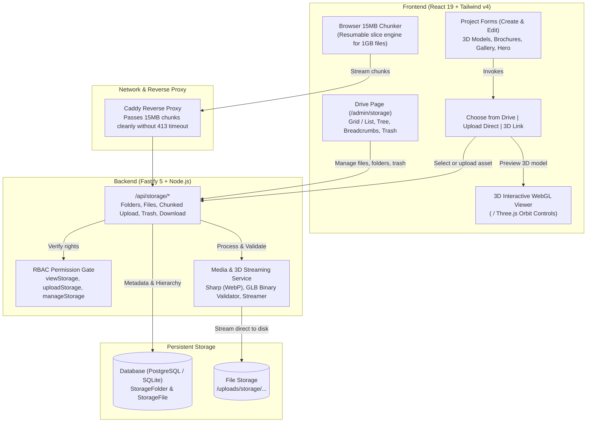
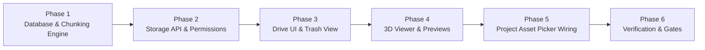

# Ajda Storage Library & Asset Management — Comprehensive Plan

> **Goal**: Build a Google Drive-like digital asset manager (DAM) embedded inside the Ajda administrative dashboard. Allows administrators to create and organize nested folders, upload/download files, soft-delete into a Trash (سلة المحذوفات) with one-click restore and permanent purge, enforce granular RBAC permissions, support massive **1 GB 3D models** (`.glb`, `.gltf`, `.obj`), and seamlessly select or upload 3D models, PDF brochures, and images directly in Project and CMS forms.

---

## 1. System Architecture



---

## 2. 1 GB 3D Model Technical Strategy

Uploading and serving files up to **1 GB** (`.glb`, `.gltf`, `.obj`) requires dedicated engineering to prevent Node.js heap crashes, network drops, and reverse proxy timeouts:

### 2.1 Resumable Chunked Upload Engine
* **The Problem with Direct 1GB POST**:
  * In-memory buffers (`data.toBuffer()`) trigger V8 heap exhaustion and crash Node.js.
  * Reverse proxies (Caddy, Cloudflare 100MB client body limit) immediately reject single 1GB POST requests with `HTTP 413 Payload Too Large`.
  * Flaky connections that drop at 900MB would force the user to re-upload from 0MB.
* **The Solution**:
  1. The browser slices files > 50MB into **15 MB chunks** using native Web `File.slice()`.
  2. Each chunk is streamed directly into an appended disk stream (`fs.createWriteStream({ flags: 'a' })`) in temporary storage.
  3. **Server RAM remains flat (< 20 MB)** regardless of total file size.
  4. **Pause, Resume & Retry**: If chunk #42 fails due to a network glitch, only that 15 MB chunk retries without restarting the upload.
  5. Upon completion, the server validates the binary header (magic bytes `0x46546C67` for `glTF`), extracts metadata, records the entry in Prisma, and cleans up temporary chunk records.

### 2.2 Byte-Range Delivery (HTTP 206 Partial Content)
* Fastify serves 3D models with `Accept-Ranges: bytes` enabled.
* WebGL 3D viewers can fetch geometry headers, material libraries, and mesh buffers progressively via Range requests without blocking the browser thread or forcing a 1GB upfront download before rendering.

### 2.3 Supported 3D Formats & MIME Handling
| Format | Extension | MIME Type | Verification Method |
| :--- | :--- | :--- | :--- |
| **glTF 2.0 Binary** (Standard) | `.glb` | `model/gltf-binary` | First 4 bytes must be `0x46546C67` (`glTF`) + version 2. |
| **glTF JSON + Bin** | `.gltf` | `model/gltf+json` | JSON structure with `"asset": { "version": "2.0" }`. |
| **3D CAD / Wavefront** | `.obj` | `text/plain` | ASCII vertices/faces structure validation. |
| **Apple AR QuickLook** | `.usdz` | `model/vnd.usdz+zip` | Zip archive containing USD assets. |

---

## 3. Database Schema & Data Modeling

### 3.1 Prisma Models (`server/prisma/schema.prisma`)

```prisma
/// Represents a virtual directory hierarchy in the storage drive
model StorageFolder {
  id          String          @id @default(uuid())
  name        String          // Folder name, e.g. "مشروع برج العليا"
  parentId    String?         // Self-referencing FK for nested subfolders
  parent      StorageFolder?  @relation("FolderTree", fields: [parentId], references: [id], onDelete: Cascade)
  children    StorageFolder[] @relation("FolderTree")
  files       StorageFile[]
  path        String          // Materialized path, e.g. "/projects/206/" for fast subtree queries
  color       String?         // Optional folder color tag (blue, amber, emerald, violet)
  createdById String?
  isDeleted   Boolean         @default(false)
  deletedAt   DateTime?       // Set when moved to Trash
  createdAt   DateTime        @default(now())
  updatedAt   DateTime        @updatedAt

  @@index([parentId])
  @@index([isDeleted])
  @@index([path])
  @@map("storage_folders")
}

/// Represents an uploaded media asset (3D model, PDF, image, video, document)
model StorageFile {
  id           String         @id @default(uuid())
  folderId     String?        // Null = root folder
  folder       StorageFolder? @relation(fields: [folderId], references: [id], onDelete: SetNull)
  name         String         // Display title (e.g. "المجسم ثلاثي الأبعاد - الطابق الأرضي")
  originalName String         // Original filename (e.g. "tower-ground-v2.glb")
  mimeType     String         // e.g. "model/gltf-binary", "application/pdf", "image/webp"
  extension    String         // e.g. "glb", "pdf", "webp"
  fileType     String         // 'model3d' | 'pdf' | 'image' | 'video' | 'document' | 'other'
  size         BigInt         // BigInt to safely handle 1GB+ files (bytes)
  url          String         // Serving URL (e.g. "/uploads/storage/uuid.glb")
  storageKey   String         // Disk path
  thumbnailUrl String?        // Auto-generated thumbnail for images and preview posters
  metadata     String?        // JSON: { width, height, polygonCount, isChunked }
  createdById  String?
  isDeleted    Boolean        @default(false)
  deletedAt    DateTime?      // Set when moved to Trash
  createdAt    DateTime       @default(now())
  updatedAt    DateTime       @updatedAt

  @@index([folderId])
  @@index([fileType])
  @@index([isDeleted])
  @@index([createdAt])
  @@map("storage_files")
}
```

### 3.2 Dual-Database Migration Strategy
* **PostgreSQL (Production)**: Handcrafted SQL migration in `server/prisma/migrations/20261108000000_storage_drive/migration.sql`.
* **SQLite (Dev & Tests)**: Direct sync via `prisma db push` / `prisma generate`.

---

## 4. Permissions & Role-Based Access Control (RBAC)

Integrated into `server/src/config/permissions.ts` and `src/config/permissions.ts`:

| Permission Key | Group | Arabic Label | English Label | Description |
| :--- | :--- | :--- | :--- | :--- |
| `viewStorage` | `storage` | استعراض خزانة الملفات | View Storage Drive | Browse files and folders, preview files, and select assets for projects and CMS. |
| `uploadStorage` | `storage` | رفع وتنظيم الملفات | Upload & Organize Files | Upload new files (including 1GB 3D models), create new folders, rename and move files. |
| `manageStorage` | `storage` | إدارة خزانة الملفات (كاملة) | Full Storage Management | Move items to Trash, restore items, permanently empty Trash, and manage system folders. |

* **Role Assignments**:
  * `super_admin`: Full access (`manageStorage`, `uploadStorage`, `viewStorage`).
  * `project_manager`: `uploadStorage` + `viewStorage` (can organize and upload project assets, but cannot permanently delete or empty trash).
  * `sales_agent` / `viewer`: `viewStorage` (read-only and asset selection).

---

## 5. Storage API Specification (`/api/storage/*`)

```http
# --- FOLDER OPERATIONS ---
GET    /api/storage/folders?parentId={id}         # List subfolders and files in folder
GET    /api/storage/folders/tree                  # Full directory tree for sidebar navigation
POST   /api/storage/folders                       # Create folder { name, parentId? }
PATCH  /api/storage/folders/:id                   # Rename or move folder { name?, parentId? }
DELETE /api/storage/folders/:id                   # Move folder and contents to Trash (soft delete)

# --- RESUMABLE CHUNKED UPLOADS (for 1GB 3D Models & Large Files) ---
POST   /api/storage/upload/init                   # Init upload session { filename, size, mimeType, folderId } -> { uploadId, chunkSize }
POST   /api/storage/upload/chunk                  # Multipart stream single chunk { uploadId, chunkIndex, file }
POST   /api/storage/upload/complete              # Finalize session { uploadId } -> { file: StorageFile }
DELETE /api/storage/upload/cancel                # Abort session and cleanup temp chunks { uploadId }

# --- STANDARD UPLOAD (for small images & PDFs < 50MB) ---
POST   /api/storage/files/upload                  # Standard multipart single upload

# --- FILE OPERATIONS ---
GET    /api/storage/files?folderId={id}&type={t}  # Search & filter files
PATCH  /api/storage/files/:id                     # Rename or move file { name?, folderId? }
DELETE /api/storage/files/:id                     # Move file to Trash (soft delete)
GET    /api/storage/files/:id/download            # Stream download with Content-Disposition

# --- TRASH & RESTORATION ---
GET    /api/storage/trash                         # List all trashed items
POST   /api/storage/trash/restore                 # Restore files & folders { fileIds?: [], folderIds?: [] }
DELETE /api/storage/trash/purge                   # Permanently delete selected items from disk
DELETE /api/storage/trash/empty                   # Empty entire trash (requires manageStorage)
```

---

## 6. Frontend UI Components (`src/`)

### 6.1 Admin Drive Dashboard (`/admin/storage`)
* **Folder & File Explorer**:
  * Clickable breadcrumb trail (`خزانة الملفات / المشاريع / برج العليا`).
  * Quick filter sidebar: All Files (جميع الملفات), 3D Models (المجسمات ثلاثية الأبعاد), PDFs (الملفات والعروض), Images (الصور), Trash (سلة المحذوفات).
  * Search input with live debouncing and sorting (Date, Name, Size, Type).
  * Dual view modes: Visual Grid View vs Detailed Table View.
  * Multi-file drag & drop with an interactive upload tray showing chunk progress (`450 MB / 1024 MB - 44%`).
* **Trash (سلة المحذوفات)**:
  * Dedicated section showing deletion date and original folder path.
  * "استعادة" (Restore) and "حذف نهائي" (Permanent Delete) with confirmation modals.

### 6.2 3D Model Interactive Viewer (`<Model3dViewer />`)
* Embedded WebGL viewer supporting `.glb` files up to 1GB:
  * Orbit controls: 360° rotation, pan, zoom.
  * Progressive loading indicator displaying downloaded MBs.
  * Wireframe toggle and lighting adjustments.
  * Handles both uploaded `.glb` files and external 3D virtual tour iframe URLs (Matterport / Kuula).

### 6.3 Reusable Asset Picker Modal (`<AssetPickerModal />`)
Wired into **Project Create/Edit**, **Past Projects**, and **CMS**:
* **Tab 1: اختر من الخزانة (From Drive)**: Browse folders, filter by `model3d`, `pdf`, or `image`, and select.
* **Tab 2: رفع مباشر (Direct Upload)**: Slices and uploads 1GB 3D models or images directly with progress bar, saves into the project folder, and auto-selects.
* **Tab 3: رابط خارجي (External Link)**: For external 3D virtual tour URLs.

---

## 7. Phased Implementation Roadmap



### Phase 1: Database & Streaming Upload Core
- [ ] Add `StorageFolder` and `StorageFile` models to `server/prisma/schema.prisma` with `BigInt` size.
- [ ] Create handcrafted PostgreSQL migration in `server/prisma/migrations/`.
- [ ] Build chunked upload service in `server/src/services/chunkedUploadService.ts` with streaming disk append (`fs.createWriteStream`).
- [ ] Add permission keys (`viewStorage`, `uploadStorage`, `manageStorage`) to `server/src/config/permissions.ts` and `src/config/permissions.ts`.

### Phase 2: Storage API & Fastify Routes
- [ ] Implement `server/src/routes/storage.routes.ts`:
  - Folder CRUD (tree, create, rename, move, soft delete).
  - Chunked upload session routes (`init`, `chunk`, `complete`, `cancel`).
  - File CRUD (search, rename, move, soft delete, streaming download with byte-range support).
  - Trash management (list, restore single/batch, permanent purge, empty trash).
- [ ] Add server test suite: `server/test/storage.test.ts` verifying all routes, authorization checks, and trash lifecycle.

### Phase 3: Admin Drive UI & Trash View
- [ ] Build `/admin/storage` route and page component:
  - `StoragePage.tsx` with responsive layout (sidebar tree, breadcrumb bar, grid/list toggle).
  - `FolderCard.tsx` and `FileCard.tsx` with thumbnail renderers and contextual action menus.
  - `NewFolderModal.tsx`, `MoveItemModal.tsx`, and `UploadProgressDrawer.tsx`.
- [ ] Build `TrashSection.tsx` for managing deleted items with restore and purge actions.
- [ ] Add full Arabic and English translations in `src/i18n/admin/storage.ts`.

### Phase 4: 3D Model Viewer & Previews
- [ ] Implement `<Model3dViewer />` supporting `.glb`/`.gltf` rendering with orbit controls, loading progress, and fallback for external iframe links.
- [ ] Implement `<FilePreviewModal />` unified previewer for 3D models, PDF brochures, and high-res images.

### Phase 5: Reusable Asset Picker & Project Form Integration
- [ ] Build `<AssetPickerModal />` with tabs: "From Drive", "Upload Direct", and "External URL".
- [ ] Wire `<AssetPickerModal />` into:
  - `src/components/admin/ProjectCreateModal.tsx` (Hero image, Brochure PDF, 3D Model).
  - `src/pages/admin/sections/ProjectEditSection.tsx` (Hero image, Gallery, Brochure PDF, 3D Model).
  - `src/pages/admin/sections/PastProjectsSection.tsx` (Image, Gallery, PDF).
  - `src/pages/ProjectDetailPage.tsx` (ensure uploaded `.glb` files render directly in the 3D viewer modal, while external links render in the iframe).

### Phase 6: Verification, Gates & Documentation
- [ ] Run full project gates:
  - `npm run lint` (0 new warnings).
  - `npm run build` (Vite SPA production build).
  - `npm --prefix server run build` (Fastify TypeScript compile).
- [ ] Browser QA: Test RTL (Arabic) & LTR (English), mobile responsiveness (390px), drag-and-drop chunked uploads, trash/restore flow, and 3D preview.
- [ ] Update `docs/api-reference.md`, `docs/architecture.md`, and `CHANGELOG.md`.

---

## 8. Key Architectural Notes for the Owner

1. **Storage Backend**: Stored on local disk under `server/uploads/storage/`. The service abstraction allows switching to Cloudflare R2 or AWS S3 in the future without changing API contracts.
2. **Chunking Performance**: With 15 MB chunks, uploading a 1 GB file requires ~68 requests. Each chunk finishes in ~1-3 seconds on typical broadband, offering smooth progress updates and automatic retry on connection drops.
3. **Trash Retention**: Soft-deleted files remain in Trash indefinitely until an administrator with `manageStorage` clicks "Empty Trash" or restores them.
